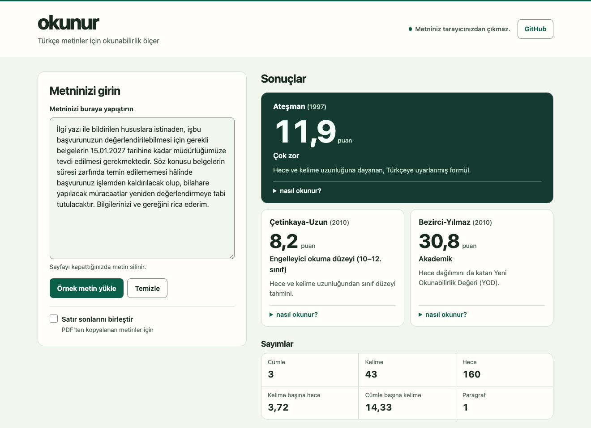

# okunur

Türkçe metinlerin okunabilirliğini ölçen açık kaynak araç: **Ateşman (1997)**, **Çetinkaya-Uzun (2010)** ve **Bezirci-Yılmaz (2010)** puanları, temel sayımlar ve cümle bazında sadeleştirme önerileri.

[](https://github.com/avazargozalli/Okunur/actions/workflows/ci.yml)
[](https://www.npmjs.com/package/okunur)
[](LICENSE)

[Web uygulaması](https://avazargozalli.github.io/Okunur/) · [English](README.en.md) · [Yöntem](docs/yontem.md) · [Kararlar](docs/kararlar.md)

> Metniniz tarayıcınızdan çıkmaz.

## Ne yapar?

- **Üç puan:** Ateşman, Çetinkaya-Uzun ve Bezirci-Yılmaz formülleriyle okunabilirlik puanı ve düzey etiketi.
- **Sayımlar:** Cümle, kelime, hece, hece dağılımı, kelime başına hece ve cümle başına kelime ortalamaları.
- **Tanılama:** Uzun cümleler, uzun kelimeler ve ağır/bürokratik sözcükler için sade karşılık önerileri.



## Hemen dene

Kurulum gerektirmeden tarayıcıda deneyin: <https://avazargozalli.github.io/Okunur/>

Komut satırında:

```bash
npx okunur dosya.txt
```

## Kurulum ve kullanım

### Kütüphane

```bash
npm install okunur
```

```ts
import { analyze } from "okunur";

const { counts, scores } = analyze("Kedi süt içti. Sonra uyudu.");
console.log(counts);
console.log(scores?.atesman);
```

Örnek çıktı:

```text
{
  characters: 27,
  letters: 21,
  words: 5,
  sentences: 2,
  syllables: 10,
  paragraphs: 1
}
{ score: 111.94999999999999, level: 'cok-kolay', label: 'Çok kolay' }
```

`score` ham (yuvarlanmamış) değerdir; insan okur raporda bir ondalık basamağa yuvarlanır.

### Komut satırı

```bash
npx okunur ornek.txt
```

T3 örneği için beklenen çıktı (şartname Bölüm 9'daki birebir çıktı):

```text
okunur — ornek.txt

Ateşman           48,6  Zor
Çetinkaya-Uzun    26,6  Engelleyici okuma düzeyi (10–12. sınıf)
Bezirci-Yılmaz    12,3  Lisans

Cümle: 5 · Kelime: 35 · Hece: 115
Kelime başına hece: 3,29 · Cümle başına kelime: 7,00

Uyarılar
  ! Metin 100 kelimeden kısa; formül sonuçları kısa metinlerde güvenilir değildir.

Bulgular (1)
  5. cümle · "bakabilirsiniz": 6 heceli uzun kelime. Daha kısa bir karşılığı var mı?
```

Diğer kullanımlar:

```bash
npx okunur --json ornek.txt          # JSON çıktı
npx okunur --join-lines pdf.txt      # PDF'ten kopyalanan satırları birleştir
npx okunur --no-suggestions metin.txt
cat metin.txt | npx okunur --quiet -
```

### CI'da kullanım

`--min-atesman` ile eşik altındaki belgelerde hata koduyla çıkabilirsiniz:

```yaml
- name: Okunabilirlik eşiği
  run: npx okunur@0.1.0 --min-atesman 50 belge.txt
```

Puan eşiğin altındaysa çıkış kodu `1` olur ve iş akışı durur; kullanım ya da dosya okuma hatasında çıkış kodu `2` olur.

## Puanlar nasıl okunur?

Üç formül de kelime ve cümle uzunluklarından (Bezirci-Yılmaz ayrıca hece dağılımından) hesaplanır. **Ateşman ve Çetinkaya-Uzun'da yüksek puan kolay metin**, **Bezirci-Yılmaz'da yüksek değer zor metin** anlamına gelir. Ateşman ve Çetinkaya-Uzun puanları 100'ü aşabilir ya da sıfırın altına inebilir; kırpılmaz.

### Ateşman (1997)

| Puan | Düzey         |
| ---- | ------------- |
| ≥ 90 | Çok kolay     |
| ≥ 70 | Kolay         |
| ≥ 50 | Orta güçlükte |
| ≥ 30 | Zor           |
| < 30 | Çok zor       |

### Çetinkaya-Uzun (2010)

| Puan | Düzey                                   |
| ---- | --------------------------------------- |
| ≥ 51 | Bağımsız okuma düzeyi (5–7. sınıf)      |
| ≥ 35 | Eğitsel okuma düzeyi (8–9. sınıf)       |
| < 35 | Engelleyici okuma düzeyi (10–12. sınıf) |

### Bezirci-Yılmaz (2010), Yeni Okunabilirlik Değeri

| YOD  | Düzey      |
| ---- | ---------- |
| ≤ 8  | İlköğretim |
| ≤ 12 | Lise       |
| ≤ 16 | Lisans     |
| > 16 | Akademik   |

Düzey her zaman yuvarlanmamış puandan belirlenir; gösterimde puan bir ondalık basamağa yuvarlanır. Ayrıntılı formüller ve gerekçeler: [docs/yontem.md](docs/yontem.md).

## Nasıl ölçer?

`okunur` metni önce normalize eder (Unicode NFC, görünmez karakterler, boşluklar, kesme işaretleri); sonra Türkçeye özgü kurallarla bloklara, cümlelere ve kelimelere ayırır. Kısaltmaları, sayıları, URL'leri, e-postaları, birimleri ve kesme işaretli ekleri ayrı ayrı ele alır. Heceyi ünlü sayısından hesaplar; sayıları Türkçe okunuşlarına çevirerek heceler. Üç formülü ham sayımlardan hesaplar, düzey etiketlerini üretir. Uzun cümleleri ve kelimeleri işaretler, tablodaki ağır sözcükler için sade karşılık önerir. Aynı girdi her ortamda aynı çıktıyı verir; ağ çağrısı, model ya da sözlük indirme yoktur.

Kuralların tamamı, tablolar, formüller ve örnekler: [docs/yontem.md](docs/yontem.md).

## Sınırlar

Bilinen sınırlamaların tamamı aşağıdadır:

1. Formüller yalnızca kelime ve cümle uzunluğuna bakar; anlamı, tutarlılığı, okurun ön bilgisini ölçmez. Puan bir tahmindir.
2. Formüller en az 100 kelimelik düzyazı için tasarlanmıştır; şiir, liste, tablo, çok kısa metinlerde sonuç yanıltıcıdır.
3. Yabancı kökenli sözcüklerde ünlü sayısı hece sayısını tutmayabilir (`online`, `iPhone`).
4. Kısaltmaların okunuşu kural tabanlıdır; tabloda olmayan kısaltmalarda sapma olabilir.
5. 1–2 basamaklı sayı + nokta her zaman sıra sayısı sayılır; cümle sonundaki böyle bir sayı (`Sonuç 25. Ankara…`) sonraki cümleyle birleşir.
6. `bas` sınıfı kısaltmalar ve tek harf + nokta hiçbir zaman cümle bitirmez; nadiren iki cümle birleşebilir.
7. Büyük harfle başlayan bir sözcükten önceki numaralı satır başı (`2. Dünya Savaşı…`) liste işareti sayılır ve sayı atılır.
8. İngiliz biçimli ondalıklar (`3.14`) "üç on dört" okunur; `virgül` sayılmaz.
9. Tarih ve saatler basitçe sayı grupları olarak okunur (ay adı, "buçuk" vb. yok).
10. Sade karşılık listesi küçüktür ve bağlama bakmaz; öneriler her cümlede uygun olmayabilir.
11. Farklı araçlar ve elle sayım, cümle/kelime tanımları farklı olduğu için farklı puan verebilir. Bu araç kurallarını açıkça yayımlar; karşılaştırma yaparken yöntemi belirtin.

Bu maddelerin gerekçeleri ve kabul kararları: [docs/kararlar.md](docs/kararlar.md).

## Katkı

Katkı rehberi: [CONTRIBUTING.md](CONTRIBUTING.md). En kolay katkı yolları:

- **Yanlış sonuç bildir:** [yanlış sonuç şablonu](https://github.com/avazargozalli/Okunur/issues/new?template=yanlis-sonuc.yml) — metni, beklediğiniz cümle/kelime/hece sayısını ve aracın verdiği sonucu yazın.
- **Sade karşılık öner:** [öneri şablonu](https://github.com/avazargozalli/Okunur/issues/new?template=oneri.yml) — kısaltma, sade karşılık ya da özellik önerisi.
- **Hata bildir:** [hata şablonu](https://github.com/avazargozalli/Okunur/issues/new?template=hata.yml).
- Kod katkısı için önce `npm ci` ve `npm run check` çalıştırın; ayrıntılar CONTRIBUTING'de.

### Sırada ne var?

Bu sürümde yapılmayan, ileride değerlendirilecek işler: aynı test vektörlerini kullanan Python paketi; Markdown kipinde kod bloklarının ve tabloların atlanması; sade karşılık listesinin topluluk katkısıyla büyütülmesi ve alan bazlı listeler (hukuk, sağlık); tarayıcı ve VS Code eklentileri; toplu dosya analizi için CSV çıktısı; Sönmez (2003) ve diğer Türkçe ölçütler.

## Atıf

Akademik bir çalışmada kullanırsanız lütfen yazılımı ve yöntemi atıfla belirtin. Hazır künye: [CITATION.cff](CITATION.cff).

```bibtex
@software{okunur2026,
  title   = {okunur: Türkçe metinler için okunabilirlik ölçer},
  author  = {Azar Gozalli},
  year    = {2026},
  version = {0.1.0},
  url     = {https://github.com/avazargozalli/Okunur},
  note    = {Algoritma sürümü 1}
}
```

Kaynakça:

- Ateşman, E. (1997). Türkçede okunabilirliğin ölçülmesi. _Dil Dergisi_, 58, 71–74.
- Bezirci, B. ve Yılmaz, A. E. (2010). Metinlerin okunabilirliğinin ölçülmesi üzerine bir yazılım kütüphanesi ve Türkçe için yeni bir okunabilirlik ölçütü. _Dokuz Eylül Üniversitesi Mühendislik Fakültesi Fen ve Mühendislik Dergisi_, 12(3), 49–62.
- Çetinkaya, G. (2010). _Türkçe metinlerin okunabilirlik düzeylerinin tanımlanması ve sınıflandırılması_ (Doktora tezi). Ankara Üniversitesi.
- Flesch, R. (1948). A new readability yardstick. _Journal of Applied Psychology_, 32(3), 221–233.

## Lisans

MIT Lisansı, 2026, Azar Gozalli ve okunur katkıcıları. [LICENSE](LICENSE)
